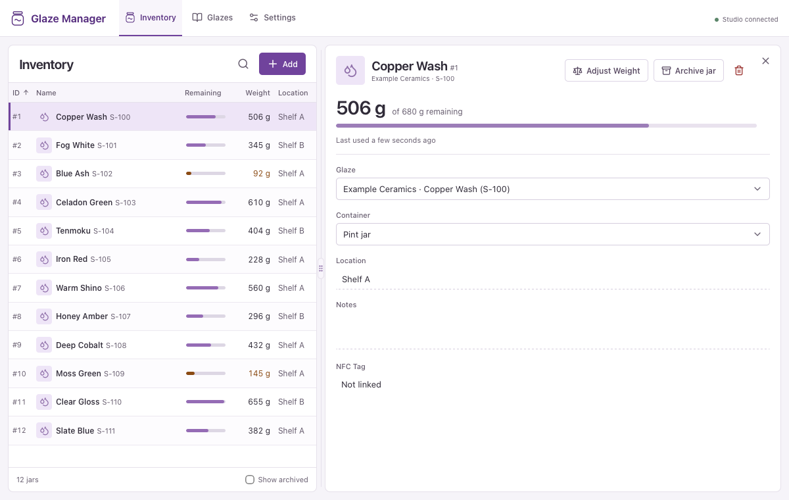
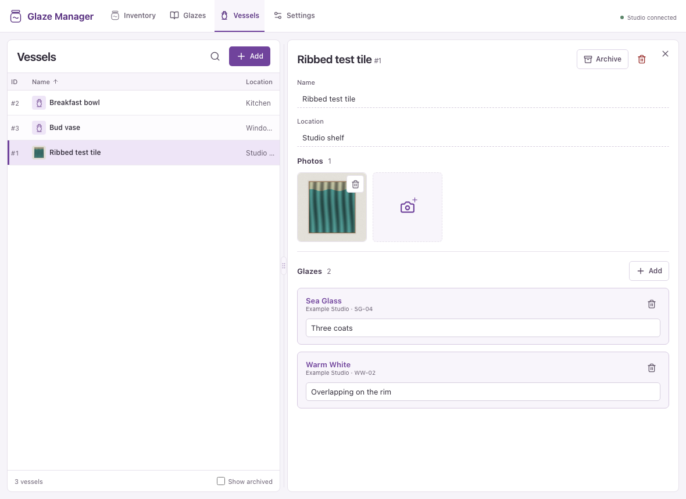

# Glaze Manager

[](https://github.com/nebhale/glaze-manager/actions/workflows/ci.yaml)
[](https://github.com/nebhale/glaze-manager/releases/latest)

Glaze Manager keeps a pottery studio’s glaze jars, shelf locations, and remaining weights in one searchable inventory. Open a jar to record a scale reading, or use an NFC-equipped scale to identify and weigh it through the device API. Low-stock jars stand out in the list so you can see what to reorder.



## Quick start

Run the published Linux image on an AMD64 or ARM64 host with Docker Compose. Download the [1.4.0 Compose file](https://raw.githubusercontent.com/nebhale/glaze-manager/v1.4.0/compose.yaml) into a directory for the studio, then run:

```sh
docker compose up -d
```

Open [Glaze Manager](http://localhost:8000). The Compose file pins the image to `ghcr.io/nebhale/glaze-manager:1.4.0`. A named volume stores the SQLite database, glaze photos, and weight history between restarts.

The default address is loopback. To connect phones and scales, set `GLAZE_BIND_ADDRESS` to your server’s trusted LAN address and run Compose again. Anyone who can reach the app can change inventory. Restrict remote access to a VPN or an authenticated HTTPS proxy.

## Stock your first shelf

1. In **Settings**, add a manufacturer and a container with its empty weight in grams.
2. Under **Glazes**, add a glaze. Record its manufacturer, product line, product code, cone, or reference photos as useful.
3. In **Inventory**, add a jar, choose its glaze and container, and enter a location.
4. Use **Adjust Weight** in Jar Detail to enter a gross reading, including the container. With a compatible scale, link the NFC tag there and confirm readings directly on the scale.

The inventory shows grams of glaze remaining after subtracting the empty container weight. For example, a 756 g jar with a 250 g container holds 506 g of glaze. The first positive confirmed device reading supplies a missing starting weight. The bar compares net remaining glaze with net starting glaze. Low-stock warnings work as soon as remaining grams are known, even without a starting weight. Set the studio-wide threshold in **Settings** (default 150 g).

Search by glaze, manufacturer, product line, code, location, or exact jar number such as `#12`. Select a row to open its detail pane. On a phone, use **Inventory** to return to the list. **Archive** keeps the jar and its readings for later. **Delete** asks for confirmation before permanently removing a jar and its readings.

## Record a vessel

In **Vessels**, enter a name and an optional location, then upload photos and select the glazes you used. Vessel locations suggest places used for vessels, and jar locations suggest places used for jars. Each piece gets a permanent vessel number starting at #1. Search by name, location, or number to find it again. Each glaze application has an optional note, with suggestions from earlier entries. You can record the same glaze several times to distinguish a base coat from a later application.

Open a glaze to see its reference photos alongside photos of the vessels that use it. Select the vessel name beneath a photo to manage that photo, or use the vessel list below **Jars** to open a piece.

**Archive** hides a vessel from the default list while keeping its photos and glaze history accessible. Turn on **Show archived** to find it and choose **Restore vessel** to return it to the active list.



## Run and integrate

- [Operations](docs/operations.md) covers configuration, backup, restore, and upgrades. Back up the entire data volume before upgrading.
- [Device API](docs/device-api.md) documents NFC lookup and binding, confirmed measurements, revision checks, and safe retries. Scale firmware is developed separately. Explore the [interactive API](http://localhost:8000/docs) on a running instance.
- [Container images](https://github.com/nebhale/glaze-manager/pkgs/container/glaze-manager) and [release notes](https://github.com/nebhale/glaze-manager/releases) are published for each stable release.
- [Contributing](CONTRIBUTING.md) covers local development, tests, pull requests, and publishing. Use [Issues](https://github.com/nebhale/glaze-manager/issues) for bugs and feature requests, and [private reporting](SECURITY.md) for security issues.

Glaze Manager is licensed under [Apache 2.0](LICENSE). [Third-party notices](THIRD_PARTY.md) describe the software distributed with it.
